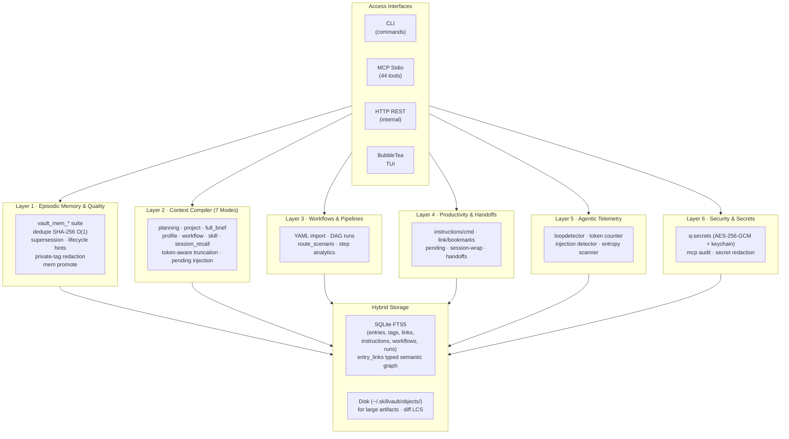

# Architecture

## Overview: 8-Layer Functional Architecture

SkillVault is not a simple KV store or note-taking app. It is an 8-layer knowledge runtime with an episodic memory engine, adaptive context compiler, agentic telemetry, and an integrated PR factory.



### Functional Modules Summary

| Layer | Module | Key Files | Responsibility |
|:---:|:---|:---|:---|
| 1 | Episodic Memory & Quality | `internal/app/vault_mem.go`, `internal/db/memory_quality.go` | SHA-256 dedupe O(1), supersession, lifecycle hints, `StripPrivateTags`, `mem promote` |
| 2 | Context Compiler | `internal/context/compiler.go` | 7 adaptive modes, token-aware truncation, priority-based section ranking, pending injection |
| 3 | Workflows & Pipelines | `internal/app/workflows.go`, `workflow_runs.go` | YAML import, DAG execution, `route_scenario`, step analytics |
| 4 | Productivity & Handoffs | `internal/app/instruction.go`, `link.go`, `session.go` | `cmd`/instructions, URL bookmarks, pending items, session wrap, agent handoffs |
| 5 | Agentic Telemetry | `internal/agenttelemetry/` | Loop detection, token counting, injection detection, entropy scanning, telemetryd daemon |
| 6 | Security & Secrets | `internal/security/`, `q-secrets/` | AES-256-GCM keychain, MCP config audit, `<private>` block redaction, secret scanner |
| — | Hybrid Storage | `internal/db/`, `internal/files/` | SQLite FTS5 + typed `entry_links` semantic graph + disk artifact objects |

---

## Clean Architecture (internal)

SkillVault sigue **Clean Architecture** (light):

```
cmd/skillvault/main.go
    │
    ├── internal/cli/     → Adapter (stdlib flags)
    ├── internal/mcp/     → Adapter (stdio JSON-RPC)
    ├── internal/api/     → Adapter (HTTP — esqueleto, futuro)
    │
    ├── internal/app/     → Use cases (services)
    │
    ├── internal/domain/  → Entities + validators (pure Go)
    │
    └── internal/db/      → Persistence (SQLite + FTS5)
    └── internal/files/   → Persistence (filesystem)
    └── internal/context/ → Compiler (Qu@ntum)
    └── internal/security/→ Scanner (secrets)
```

---

## Capas

### Domain (`internal/domain/`)

Capa más interna. No importa nada del proyecto.

- 12 tipos de entrada (EntryType), incluyendo `routing` para enrutamiento de escenarios
- Taxonomía `purpose` alineada con LifeOS: `WORK`, `KNOWLEDGE`, `LEARNING`, `RELATIONSHIP`, `STATE`, `OBSERVABILITY` (6 valores)
- 5 estados (Status)
- Value objects: Entry, Artifact, Project, Workflow, Series, Tag, EntryLink
- Validadores: `ValidateEntry()`, `ValidateProject()`, etc.
- Filtros: `EntryFilter`, `SearchQuery`

Regla: el domain no sabe de SQLite, JSON, ni nada externo. Es Go puro.

### App / Use Cases (`internal/app/`)

Orquesta el dominio y los stores. Cada servicio expone operaciones de alto nivel:

| Servicio | Operaciones |
|----------|-------------|
| `SaveEntryService` | Ejecuta validación → llama scanner de secretos → guarda en store |
| `SaveArtifactService` | Escribe archivo → guarda metadata en DB |
| `GetContextService` | Compila contexto desde DB + aplica truncado |
| `SessionService` | Crea session entry + links a proyecto/artefactos |
| `ImportExportService` | Exporta/importa vault completo con resolución de conflictos |
| `WorkflowRunService` | Ejecuta pipelines: pre-flight, inyección de variables, IO paso a paso |

### Adapters

Tres formas de hablar con SkillVault:

1. **CLI** (`internal/cli/`) — 37 comandos planos con `flag` de stdlib.
2. **MCP** (`internal/mcp/`) — Servidor JSON-RPC 2.0 sobre stdio. 24 herramientas. Expone `run_workflow` (ejecución estructurada con inputs por step), `route_scenario` (resolución de escenarios), `get_stats` (estadísticas del vault), `list_workflow_runs` (historial de ejecuciones), `get_run` (detalle de ejecución), `list_entry_versions` (historial de versiones de una entrada), y `restore_entry_version` (restaurar entrada a una versión previa). El CLI `run` se mantiene stdin/stdout para pipelines.
3. **HTTP API** (`internal/api/`) — Esqueleto vacío. Futuro.

Sibling CLIs in this repo (`cmd/telemetryd`, `cmd/line`) are **not** SkillVault adapters. `line` is a separate factory process: it may read prompt files and later SkillVault entries, but it must not fold agent spawn, CI waits, or human gates into `WorkflowRunService`. `wait_ci` talks to `gh` through a `Checker`; the LLM never polls CI. `line serve` is loopback-only; ntfy is optional and must not be required for the job to complete.

Todos los adapters llaman a los mismos `internal/app/` services.

### Persistence

#### SQLite (`internal/db/`)

7 stores, cada uno con su interfaz y tests:

- `EntryStore` — CRUD de entradas
- `ArtifactStore` — Metadata de artefactos
- `WorkflowStore` — Workflows + steps
- `SeriesStore` — Series + orden
- `TagStore` — Tags normalizados
- `EntryLinkStore` — Relaciones entre entradas
- `EntryVersionStore` — Historial de versiones de entradas (migración 009)
- `ProjectStore` — Proyectos

**FTS5**: dos tablas virtuales (`entries_fts` para contenido rico, `content_fts` para artefactos). Tokenizer `porter unicode61`.

**Migrations**: SQL embebido con `go:embed`, aplicadas por orden con `schema_migrations`. La migración 007 agrega columna `purpose` para la taxonomía LifeOS.

#### Filesystem (`internal/files/`)

Artefactos largos se guardan en disco:

```
~/.skillvault/objects/2026/06/analisis-seguridad.md
```

Cada archivo tiene hash SHA256. La metadata vive en SQLite.

---

## Flujo de datos

### Save Entry

```
CLI/MCP llama a SaveEntryService
  → ValidateEntry() (domain)
  → SecretScanner.Scan(content) (security)
    → si detecta secreto → rechaza o redacta
  → EntryStore.Save() (db)
  → TagStore.EnsureTags() (db)
  → EntryLinkStore.Save() (db, si hay links)
  → return id
```

### Get Context

```
CLI/MCP llama a GetContextService
  → valida request
  → query DB por modo (profile, project, etc.)
  → compila secciones priorizadas
  → si excede max_chars → trunca secciones de baja prioridad
  → devuelve texto estructurado
```

### Save Artifact

```
CLI/MCP llama a SaveArtifactService
  → detecta MIME type
  → genera slug + extensión
  → escribe archivo en objects/YYYY/MM/<slug>.<ext>
  → calcula SHA256 hash
  → guarda metadata en ArtifactStore (db)
  → guarda entrada tipo artifact_summary en EntryStore
```

---

## Qu@ntum Context Compiler (`internal/context/`)

7 modos de compilación:

| Modo | Prioridad alta | Prioridad media | Prioridad baja |
|------|---------------|-----------------|----------------|
| `profile` | User feedback | User entries | — |
| `project` | Project state | Decisions | Artifact summaries |
| `workflow` | Workflows | Steps | — |
| `skill` | Active skills | Prompts | — |
| `planning` | Profile | Project + workflows | Skills |
| `session_recall` | Recent sessions | Decisions | Pending |
| `full_brief` | Todo | Todo | Todo |

Prioridad de secciones (1 = más importante, 8 = menos):

1. User Preferences
2. Project State
3. Active Decisions
4. Current Workflow
5. Recent Sessions
6. Skills & Prompts
7. Artifact Summaries
8. References

El truncado elimina secciones de menor prioridad primero hasta que el contenido quepa en `max_chars`.

---

## Secret Scanner (`internal/security/`)

4 patrones regex:

| Patrón | Regex |
|--------|-------|
| OpenAI API Key | `sk-[A-Za-z0-9_-]{20,}` |
| Private Key | `-----BEGIN (RSA \| EC \| OPENSSH \|)?PRIVATE KEY-----` |
| GitHub Token | `ghp_[A-Za-z0-9_]{20,}` |
| Slack Token | `xox[baprs]-[A-Za-z0-9-]{20,}` |

Dos modos:
- **Scan**: detecta, rechaza la entrada, reporta qué se encontró
- **Redact**: reemplaza los secretos con `[REDACTED]` y permite guardar

---

## Design Decisions

| Decisión | Razón |
|----------|-------|
| Sin ORM | SQLite queries son simples, el overhead de un ORM no aporta |
| Sin Cobra | `flag` de stdlib alcanza para 37 comandos planos |
| Slugs como IDs | Legibles, estables, se pueden usar en URLs y MCP |
| Soft delete | No se pierde history; `archived` excluye de context |
| `modernc.org/sqlite` | Única dependencia externa. Sin CGO. Binario portable. |
| FTS5 standalone | `CREATE VIRTUAL TABLE` sin content= para compatibilidad con in-memory SQLite en tests |
| SHA256 hashing | Verificación de integridad de artefactos sin depender de git |
| Normalized hash dedupe | SHA-256 of trimmed+lowercased content provides O(1) dedupe on the memory write path without scanning the full project |
| Typed `entry_links` | `depends_on`, `contradicts`, `cites`, `supersedes`, `part_of` relations enable a semantic knowledge graph without a graph DB |
| `mem promote` | Frequent observations (`duplicate_count >= threshold`) are promoted to formal `decision`/`skill` entries to build canonical knowledge from agent-learned facts |
| `StripPrivateTags` | `<private>…</private>` blocks are redacted to `[REDACTED]` before FTS5 indexing and context compilation, preventing credential leaks |

## v3.8.0 memory integrity and native continuity

Memory capture uses an optional atomic store capability to commit project creation, entry/tags/FTS, deduplication, supersession, and lifecycle hints together. Migration 015 stores local retry acknowledgements keyed by caller operation ID; this journal is excluded from portable exports. Embeddings remain derived work after commit. Migration 014 reconciles graph relation constraints, and migrations from 014 onward execute transactionally.

Portable export v4 reads one SQLite snapshot and preserves quality/history/graph state; imports validate and commit authoritative data plus FTS together. Native session checkpoints reuse handoff entries and identity tags, scoped by canonical project ID and case-sensitive session/producer IDs. Recovery uses a SQLite read transaction and bounds the returned context by Unicode characters. No third memory backend is introduced.

See [Native session continuity](session-continuity.md) for identity, retry, portability and rollback limits. Agent event adapters and automatic capture remain future integrations.
